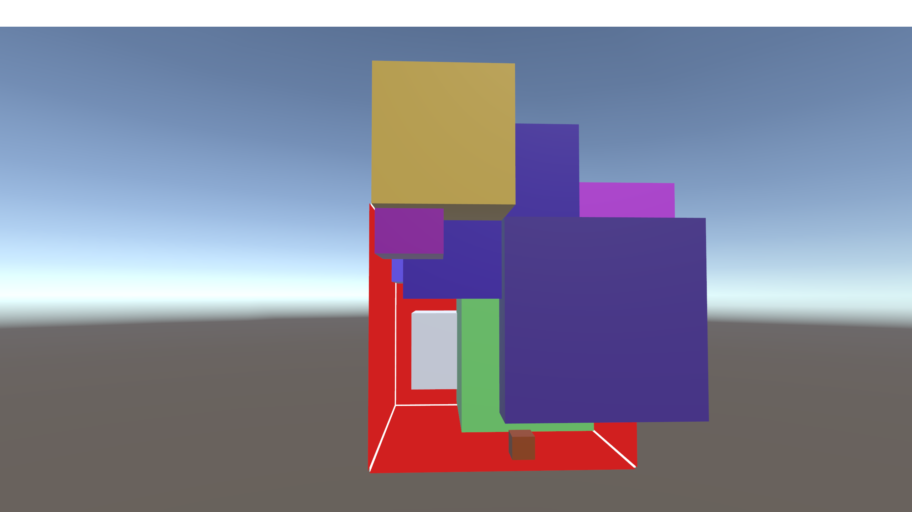
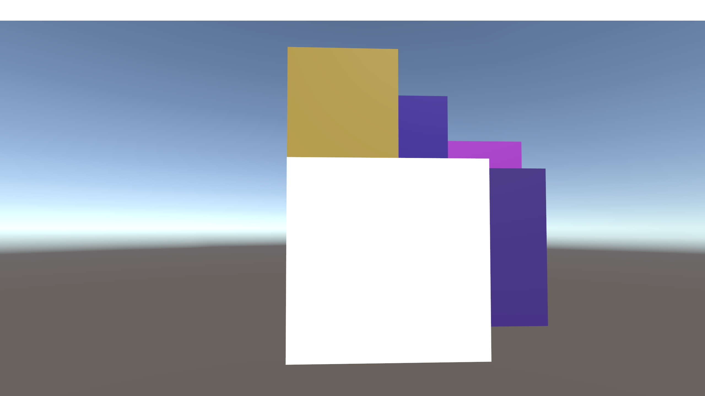
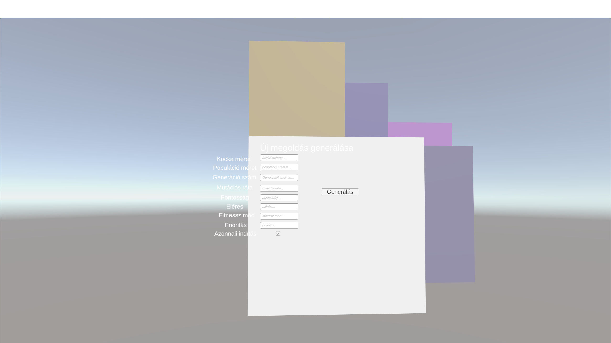
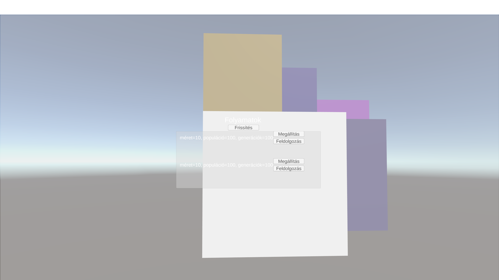
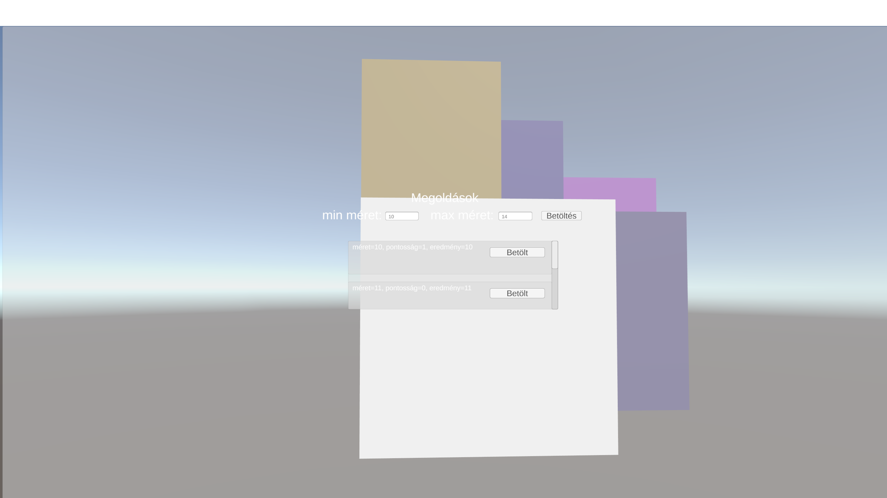

# Cube Coverage Visualizer
 
 University team project (Project Laboratory, University of Pannonia).  
 
 A Unity desktop client that visualizes the solutions of a genetic-algorithm-based **cube coverage solver** and lets you start and manage solver processes on a remote Python backend.
 
## Background
 
 The solver works on a variant of the **cube covering** problem, a relative of the well-known cube packing problem. Instead of filling a 3D volume, the goal is to cover the   **surface** of a larger cube, which is closer to surface covering and mesh coverage than to packing.
- There are n cubes with edge lengths n, n-1, ..., 1. The largest one is fixed.
- The cubes may overlap, so a cube only has to cover what is not covered yet.
- The objective is to maximize the total covered surface area of the largest cube. Overlapping areas are counted only once.
 
 The backend implements a **genetic algorithm** (selection, crossover, mutation, with two fitness functions: a Monte Carlo estimate and an exact grid coverage check) and a   **constructive heuristic** (corner-first). This client starts genetic-algorithm processes and visualizes the resulting placements.
 
## Features
- **Browse solutions in 3D:** load the best known solution for a range of cube sizes (n) and inspect it in a free-fly 3D scene.  
- **Start new genetic-** **algorithm **  **processes** from the UI, with client-side validation of every parameter before the request is sent.  
- **Manage ** **processes** **:** list the processes on the server, switch the active one, or terminate it.  
- **Camera and view controls:** free-fly camera and a hotkey that toggles the transparency of the main cube.  
- **Feedback:** success and error messages are shown as toast notifications.  
- **Works offline:** a placeholder solution is loaded at startup, so the app opens even if the backend is unreachable.  


## Screenshots

### Cube visualization – Transparent shader 



### Cube visualization – Glowing shader



### Generate a new process


### Processes panel



### Results panel

 

  
  
 
## Controls
 
 
| Input | Action |
|---|---|
| Mouse | Look around |
| WASD / arrow keys | Move |
| Shift / Ctrl | Move up / down |
| Mouse wheel | Move forward / backward |
| H | Toggle the transparency of the main cube |
| Esc | Open or close the menu |


## How it works

 Unity client (C#)  ──HTTP / JSON──►  Python FastAPI backend  ──►  genetic algorithm solver
 

 The client talks to the backend through these endpoints:  
 
 
| **Method** | **Endpoint** | **Used for** |
|---|---|---|
| GET | `/results/{n}` | Best known solution for cube size n |
| POST | `/add_genetic_process` | Start a new genetic-algorithm process |
| GET | `/processes` | List the processes on the server |
| POST | `/change_active_process/{index}` | Make a process the active one |
| POST | `/terminate_process/{index}` | Terminate a process |


 Requests are sent with UnityWebRequest inside coroutines, so the UI stays usable while a request is in progress. JSON responses are deserialized into C# classes.
 
## Parameters of a new process
 
 
| **Parameter** | **Meaning** |
|---|---|
| Cube size (n) | Edge length of the largest cube and number of cubes. Must be at least **8**. |
| Population size | Number of candidate solutions per generation. |
| Generations | Number of generations to run. Use a positive number. |
| Mutation rate | Probability (0 to 1) that a coordinate of a cube is mutated. |
| Accuracy | Number of decimals of the coordinates (0 = integer positions). |
| Reach | Controls the initial placement of the cubes. Use 1 if unsure. |
| Fitness mode | 1 = Monte Carlo estimate (fast, approximate), 2 = full grid coverage (slower, exact). |
| Priority | When a process finishes, the server continues with the process that has the highest priority. |
| Start immediately | Pauses the currently active process and starts the new one right away. |


 A quick demo: n = 8, population 20, generations 20, mutation rate 0.1, accuracy 0, reach 1, fitness mode 1, priority 0.

## Getting started

 **Download the build (Windows):** get the latest zip from the [Releases page](../../releases), extract it, and run the `.exe`. Windows may show a SmartScreen warning because the executable is not signed (*More info → Run anyway*).
 
 **Run from source:**
1. Install Unity **6000.2.7f2** (Unity 6.2).
2. Open the project folder in Unity.
3. Open Assets/Scenes/SampleScene.unity and press **Play**.
 
##  Tech
- Unity 6 (6000.2.7f2), C#, uGUI, TextMeshPro
- UnityWebRequest, coroutines, JsonUtility
- Backend (by teammates): Python, FastAPI, genetic algorithm solver
 
## Project structure
```text
Assets/
├── Data/       Example solutions (JSON)
├── Scenes/     SampleScene
└── scripts/
    ├── Camera/    Free-fly camera controller
    ├── Cube/      Builds the 3D cubes from a solution
    ├── generate/  New-process form, result loading, process list, models
    └── managers/  Panel manager, toast notifications
```

## Known limitations

- The backend address is hard-coded in the scripts under `Assets/scripts/generate/` (search for `http://`). Using another server means editing it and rebuilding.
- The UI texts and messages are in Hungarian.
- Results and processes need a reachable backend. Without it, only the placeholder solution is shown.
- There are no automated tests.

## Credits
- **Unity client:** Gergő Rácz
- **Backend and solver:** Developed by my teammates.
